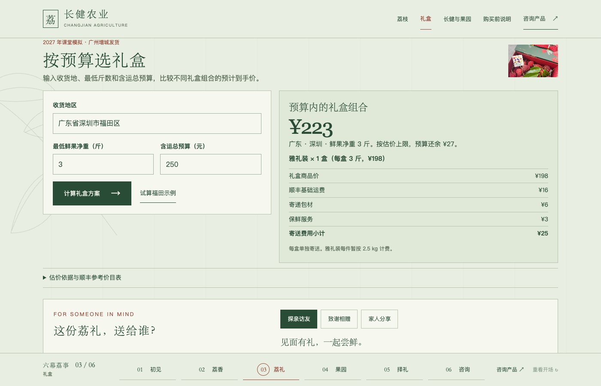

# 长健农业 · 仙进奉荔枝礼盒

BA4043 第 11 组的课程项目。我们为准备探亲送礼的访客设计了一个六幕网站。打开礼盒实拍，访客可以比较箱价与净重，再按广州增城发货和计划揽收日期判断能否赶上送礼。

**[下载网站与 PPT 演示包（ZIP）](https://github.com/jiang4wqy/ba4043-changjian-lychee/archive/refs/heads/main.zip) · [下载内部讨论用英文 PPT](https://github.com/jiang4wqy/ba4043-changjian-lychee/raw/refs/heads/main/课堂展示.pptx) · [下载研究数据 Excel](https://github.com/jiang4wqy/ba4043-changjian-lychee/raw/refs/heads/main/研究与测试/研究数据总表.xlsx)**

11 月 26 日仓库版新增[含运估价](网页/index.html#gift-estimator)。下载并解压整个 ZIP，打开[项目导览](从这里开始.html)，即可边看 PPT 边试算。11 月 25 日的部署与验收记录对应[公开课程网站](https://changjian.86.53.181.46.sslip.io/)，[当日 PPT](版本档案/课堂展示-11月25日.pptx)另行存档。



## 从哪里开始看

| 我想看 | 材料 |
|---|---|
| 网页改了什么 | [Case Study 1 提交版](研究与测试/改版前网站/) · [11 月 24 日单页选盒方案](版本档案/11月24日单页改版/) · [11 月 25 日六幕上线版](https://github.com/jiang4wqy/ba4043-changjian-lychee/tree/29786557fab457e7c4bed2e5e9419dad5b0d24a5/网页) · [11 月 26 日仓库版](网页/) · [桌面与手机截图](展示素材/功能检查.md) |
| 为什么这样设计 | [从研究、选方案到上线](设计与迭代/设计思路与建议采纳.md) · [9 项建议的采纳对照表](设计与迭代/建议采纳对照.csv) · [三种视觉方案](设计与迭代/三种视觉方案/) |
| 谁给了什么反馈 | [收到的 7 份原始互评](研究与测试/原始互评/) · [本组评阅的 6 个项目及 24 段英文原文](研究与测试/本组评阅其他组/) |
| 研究和计算能否复核 | [研究数据总表](研究与测试/研究数据总表.xlsx) · [三站 60 条正式评论、两次采集快照及脚本](研究与测试/BA4043-评论采集/) · [逐条主题编码及统计](研究与测试/BA4043-用户需求分析/) |
| 课程目标如何验证 | [选盒任务与评分规则](研究与测试/BA4043-目标与衡量/2.2-目标与衡量.md) · [选盒测试原始 Excel](研究与测试/BA4043-目标与衡量/选盒测试记录.xlsx) · [课程指南](<研究与测试/课程资料/BA4043 Group Project Guidelines (v2).pdf>) |
| 有哪些早期稿和展示素材 | [版本目录](版本档案/README.md) · [Case 1 英文报告及四份中文审阅稿](版本档案/Case-1报告/) · [设计图、照片与动效](设计与迭代/) · [最终礼赠画册](礼赠画册/) · [11 月 25 日放映片段](展示素材/放映预览.mp4) |
| 看报告与 AI 使用记录 | [英文最终报告写作模板](<报告/Final report template.docx>) · [AI 使用记录](<AI使用/AI use record.pdf>) · [证据与提示词](AI使用/证据索引.md) |

## 怎样理解这些数据

B站、京东、知乎各取 20 条公开评论。试采的 15 条包含在 60 条正式样本内。25 条提到价格或分量，其中 6 条同时提到两者。七份网站互评均提到价格或规格。第三方商品的经历均保留原对象；来稿 01–07 是文件编号。数据总表中的平台计数由逐条编码公式计算。[复算步骤与数据口径](研究与测试/数据复核.md)

项目把高端礼赠作为设计定位。两款箱价、净重和 2027 年 7 月的配送日期用于课程情境。以雅礼装寄深圳福田为例，3 斤净果（1.5 kg）按 2.5 kg 计费重量、800 公里以内估算，箱价 198 元，加基础运费 16 元、包材 6 元、保鲜 3 元，含运共 223 元。计费重量是演示假设，实际费用需核价。原选盒题的 250 元是商品预算，运费另计。11 月 25 日已有网站功能验收记录，10 人选盒测试仍待执行，记录表中的 8/10 是预设目标。

## 在本机打开

下载仓库并解压后，双击 [项目导览](从这里开始.html) 或 [网页首页](网页/index.html) 即可浏览。需要试用咨询保存和匿名计数时，在本机 Python 环境中运行以下命令，按提示设置自己的管理密码。

```powershell
cd 网页
python -m pip install -r requirements-lock.txt
python app.py --setup
python app.py
```

公开版保留项目代码、参与组号、评语和数据出处。学号、组内个人分数、访客联系方式、咨询记录及后台凭据仅由原持有人保管；文档清除了个人编辑属性。组内评分表的栏目和规则见[原表说明](研究与测试/组内评分表说明.md)。
