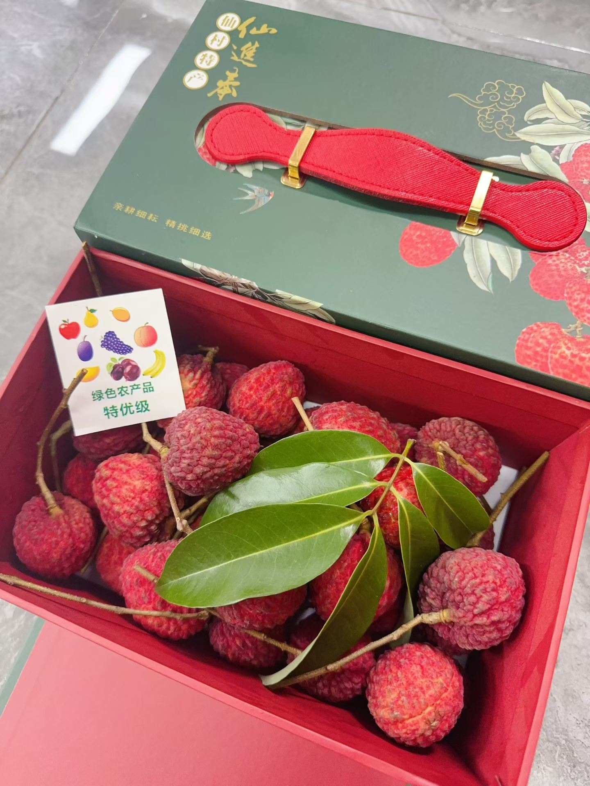
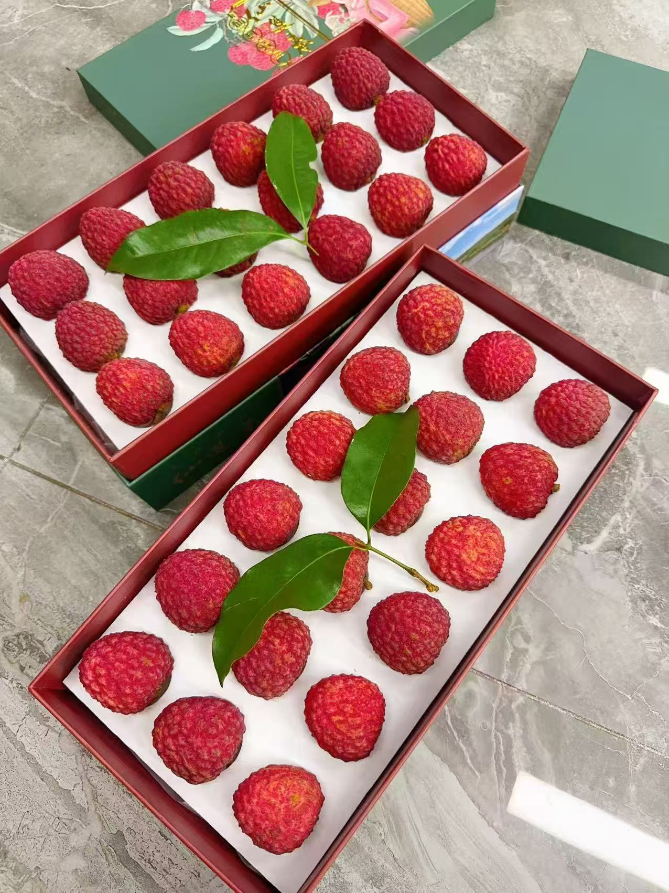

# 广州增城 · 长健农业仙进奉荔枝礼盒

仙进奉是广州增城栽培的晚熟荔枝品种。想带一盒去探亲，或寄给外地的家人，可以先看包装，再按分享人数问每盒净重，按送礼日期问发货安排。**截至 2026 年 11 月 24 日，本页尚未核实当月鲜果库存。** 当季是否可订、可以选哪些规格，请以商家对当前批次的答复为准。

## 这盒送人是什么样？

项目照片中可以看到绿色礼盒、红色提手和打开后的内包装。想了解提拿时的外观，请看第一张；想了解打开后看到什么，请看第二张。鲜果的果色、大小会有自然差异。照片用于认识包装，当前批次的包装、果数和净重请在购买前确认。

**咨询示例**  
“我想带一盒去探亲。这个批次的外盒和内包装与图片相同吗？可以看本批次的实拍、了解提手和净重吗？”

## 现在有货吗？有哪些规格、多少钱？

可订规格、每盒净重、盒数报价、库存和可发货日期随批次确认。可以直接说明准备送几个人、要几盒、预算多少。寄送时请分开确认商品价格、运费和保鲜包装费用，多地址配送也请逐个区县核实。

**咨询示例**  
“我计划买两盒送给两户家人。现在有鲜果吗？请告诉我可选净重、每盒价格和最早发货日，分寄两个区县的运费、保鲜包装如何计算？”

## 我希望在某天送到，来得及吗？

先告诉商家收货城市、区县和期望到货日，请对方核实鲜果收寄、库存、截单时间及可选班次。**下面估算的是快递从广州增城实际揽收之后的运输时间。** 采收、备货和等待揽收另计。提交咨询或付款，都不会启动这个计时。

| 收货地区 | 揽收后参考时间 | 订购前要确认 |
| --- | --- | --- |
| 广州及珠三角主要城区 | 当日–次日 | 当日送达需有可用的同城服务或早班线路，并赶上截单时间。 |
| 省外有生鲜专线的重点城市城区 | 约 1–2 天 | 先查收货区县是否覆盖，以及所选班次的预计派送日。 |
| 其他可收寄鲜荔枝的内地地区 | 约 2–3 天 | 确认具体区县的运输方式、末端派送及保鲜包装。 |
| 偏远县镇、海岛，或香港、澳门、台湾 | 请先查鲜果能否收寄 | 按收货地址确认收寄条件和运输安排，再商议日期。 |

这些区间参考了公开的广州荔枝季寄递资料，供安排送礼时估算。产季专线、承运商和班次会变化，尤其是跨省、海岛或节假日线路。商家尚未确认本批次使用哪家快递；以当天按地址查得的服务和实际揽收记录为准。

**咨询示例 · 杭州周五收礼**  
“我想寄一盒到杭州［区／县］，希望周五收到。本批有现货吗？如果周三能实际揽收，按对应线路预计哪天到？运费多少，用什么保鲜包装？”如果商家确认这条线路需 1–2 天，周三实际揽收可按周四至周五估算；仅在周三留言，仍需等商家确认何时能交给快递。

## 收到后怎么保存？有问题找谁？

签收后尽快开箱检查果品和包装，按商品随附说明及时冷藏，尽早享用。发现挤压、破损或果品异常时，保留包装并拍下外箱、面单和受影响果品，联系原购买渠道说明情况。

原项目提供的产品咨询电话为 **133 1602 2555**，也可使用原网站联系卡上的微信二维码。网站咨询表单由课程项目小组接收，提交成功后可保存咨询编号。实际订购、付款、配送及售后请与商家直接确认。

## 资料来源

- 项目原报告记录了品种、产地、包装照片来源和原站对外咨询联系方式。[Case Study 1 英文原报告](<../../../版本档案/Case-1报告/Case-1-English-report.docx>)
- 原网站列有购买前须确认的细节、收货保存提示和商家联系卡。[原项目网站源文件](<../../../研究与测试/改版前网站/index.html>)
- 广州市从化区 2025 年荔枝季公布的邮政方案说明了广州同城、珠三角早班和全国重点城市线路。这是相邻产区当季专线的参考资料。[广州市从化区人民政府 · 荔枝产季邮政寄递方案](https://www.conghua.gov.cn/ztzlzzyyzqchyw/content/post_10306995.html)
- 2025 年广州荔枝行业方案发布会上，顺丰介绍大部分地区约两天、部分较偏远地区约三天的运输情况。[广州市从化区农业农村局 · 广州荔枝寄递方案](https://www.conghua.gov.cn/zfjg/qnyncj/zwgk/zfxxgkml/gzdt/content/post_10249230.html)
- 输入增城寄件地址、收件区县和发件时间，可核对顺丰可选服务及其预估运费、时效。鲜果收寄仍需向承运方确认。[顺丰运费时效查询](https://www.sf-express.com/chn/sc/price-query)
